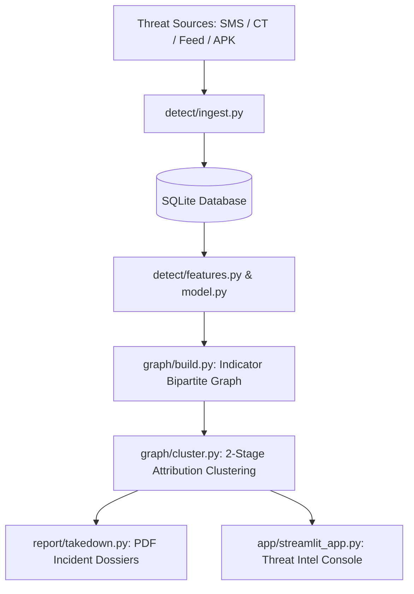

# CloneTrace 🛡️

**UPI and Banking Phishing Clone Detection & Campaign Clustering Engine**

CloneTrace detects phishing infrastructure mimicking major Indian banking and UPI platforms (PhonePe, Paytm, Google Pay, BHIM, SBI, HDFC) and aggregates disparate threat signals into correlated campaign clusters using graph attribution and community detection.

---

## Architecture Overview



---

## Repository Structure

```
clonetrace/
├── AGENTS.md                  # Development boundaries and AI governance
├── README.md                  # System overview and quickstart
├── CHANGELOG.md               # Version history and contract updates
├── .gitignore                 # Workspace ignore rules
├── requirements.txt           # Python package dependencies
├── Makefile                   # Development targets
├── config.yaml                # Detection and clustering hyper-parameters
├── db.py                      # Database access and schema initialization
├── pipeline.py                # Full end-to-end execution runner
├── contract/
│   ├── schema.sql             # Relational SQLite tables and indexes
│   └── models.py              # Pydantic v2 data models
├── detect/
│   ├── ingest.py              # Regex parsing for URLs, VPAs, Indian phone numbers
│   ├── fetcher.py             # Stub for network fetching & rendering
│   ├── features.py            # Stub for lexical & DOM feature extraction
│   ├── model.py               # Stub for scoring and classification
│   ├── apk.py                 # Stub for static APK analysis
│   └── eval.py                # Metrics evaluation against ground truth
├── graph/
│   ├── enrich.py              # Indicator enrichment
│   ├── build.py               # Graph builder with IDF & hub filtering
│   ├── cluster.py             # Two-stage strong-component + Louvain clustering
│   └── synth.py               # Synthetic benchmark dataset generator
├── report/
│   └── takedown.py            # ReportLab PDF takedown dossier generator
├── app/
│   └── streamlit_app.py       # Multi-tab threat intelligence dashboard
├── scripts/
│   └── make_seed.py           # Deterministic 41-observation seed data generator
└── tests/
    ├── conftest.py            # Isolated tmp DB test fixtures
    ├── test_smoke.py          # End-to-end pipeline & metric validation
    └── test_ingest.py         # Unit tests for text & indicator ingestion
```

---

## Quickstart

### 1. Environment Setup
```bash
make setup
```

### 2. Generate Seed Data & Run Pipeline
```bash
make seed
make pipeline
```

### 3. Launch Dashboard
```bash
make app
```

### 4. Run Test Suite
```bash
make test
```

### 5. Evaluate Metrics
```bash
make eval
```
